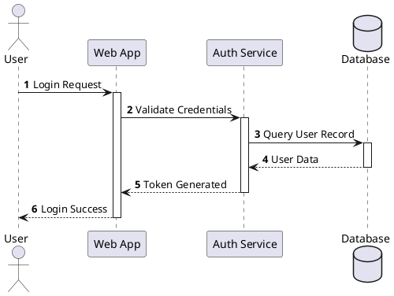

# PlantUML

PlantUML is a diagram-as-code tool that enables users to generate UML and non-UML diagrams from intuitive, plain-text descriptions. It supports sequence diagrams, class diagrams, state diagrams, activity diagrams, deployment diagrams, mindmaps, Gantt charts, and architecture models (e.g., C4).

## When to use

- **Diagram-as-Code workflows:** Storing diagrams in version control alongside application source code.
- **Automated documentation generation:** Generating architectural diagrams, entity-relationship diagrams (ERDs), or state machines as part of CI/CD pipelines.
- **System and flow visualization:** Documenting interactions, API lifecycles, and microservice communications using sequence diagrams.
- **Format conversion:** Converting `.puml` or `.plantuml` source files into vector (SVG, EPS, PDF) or raster formats (PNG) as well as ASCII/Unicode art.
- **Programmatic diagram creation:** Generating diagram specifications from codebases, schema definitions, or tracing logs using helper scripts (e.g., `sequence_generator.py`).

## How to use

### 1. Basic Diagram Syntax

Create a diagram file (e.g., `diagram.puml`):



### 2. Generating Diagrams via PlantUML CLI

PlantUML requires Java and is typically executed via its JAR distribution:

```bash
# Render to PNG (default)
java -jar plantuml.jar diagram.puml

# Render to SVG
java -jar plantuml.jar -tsvg diagram.puml

# Process all diagrams in a directory recursively
java -jar plantuml.jar -tsvg "docs/**/*.puml"

# Generate ASCII art in terminal output
java -jar plantuml.jar -ttxt diagram.puml
```

### 3. Using `sequence_generator.py`

Run the included `sequence_generator.py` script to generate sequence diagram files programmatically:

```bash
# Basic execution
python sequence_generator.py --input interactions.json --output flow.puml

# Generate and render directly to SVG (if plantuml CLI is available)
python sequence_generator.py --input interactions.json --output flow.puml --render svg
```

### 4. Running via Docker

If Java or Graphviz are not installed locally:

```bash
docker run --rm -v $(pwd):/work -w /work plantuml/plantuml -tsvg diagram.puml
```

## Limitations

- **Graphviz Dependency:** While sequence diagrams work standalone, most complex diagram types (class, state, activity, component, deployment) require Graphviz (`dot`) to be installed on the host system.
- **Layout Control:** Layouts are generated automatically using Graphviz layout engines. Fine-tuning placement and link routing in deeply nested or dense diagrams can be difficult and may require layout hints (`hidden` links, `left to right direction`, or rank constraints).
- **Runtime Requirement:** Running the official PlantUML compiler requires a Java Runtime Environment (JRE 8+).
- **Large Diagram Overhead:** Processing excessively large diagrams (thousands of nodes) can lead to significant memory consumption, high rendering times, or image dimension cutoffs (which require setting `PLANTUML_LIMIT_SIZE`).